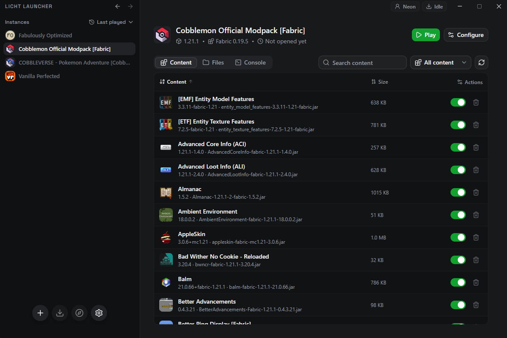

# Licht Launcher

<p align="center">
  
</p>

<p align="center">
  <strong>A light, cross-platform launcher for Minecraft: Java Edition.</strong><br>
  Built with Tauri v2, React, TypeScript, and Rust for Windows and Linux.
</p>

<p align="center">
  <a href="https://github.com/mateusneiva/licht-launcher/actions/workflows/ci.yml"></a>
  <a href="https://github.com/mateusneiva/licht-launcher/releases/latest"></a>
  <a href="https://github.com/mateusneiva/licht-launcher/releases"></a>
  <a href="LICENSE"></a>
</p>

**Current release: `0.2.3 · Iris`**

**Unofficial project, not affiliated with Mojang Studios or Microsoft.**

[Terms of Use](TERMS.md) · [Privacy Policy](PRIVACY.md) ·
[Contributing](CONTRIBUTING.md) · [Code signing policy](#code-signing-policy)



## Download

Download the latest build from the
[GitHub Releases page](https://github.com/mateusneiva/licht-launcher/releases/latest).

| Platform | Recommended download |
| --- | --- |
| Windows x64 | NSIS installer (`.exe`) |
| Linux x64 | AppImage |
| Linux distributions with Debian packages | `.deb` |

Portable binaries are also published for Windows and Linux. The updater uses
GitHub Releases as its source and verifies Tauri updater signatures for Windows
NSIS and Linux AppImage updates. See the [Code signing policy](#code-signing-policy)
for the separate Windows publisher-signing status.

Read the [Terms of Use](TERMS.md) and [Privacy Policy](PRIVACY.md) before using
the launcher. You need the appropriate Minecraft game rights; the MIT license
for Licht Launcher does not include a Minecraft license.

### Uninstall

- **Windows installer:** close the launcher and use Windows Settings > Apps to
  uninstall Licht Launcher.
- **Linux `.deb`:** remove the installed Licht Launcher package through your
  distribution's package manager.
- **AppImage or portable binary:** close the launcher, then remove the
  executable and any shortcuts you created.

To remove saved accounts and local game/launcher data as well, follow
[Retention and deletion](PRIVACY.md#retention-and-deletion). Back up worlds and
other files you want to keep first; executable removal alone may leave data
and OS keyring credentials behind.

## Code signing policy

**SignPath status: application not yet submitted; SignPath signing is not yet
integrated.** The project currently publishes Tauri updater signatures. These
allow the updater to verify update packages and are separate from Windows
Authenticode signatures identifying a publisher. No SignPath approval or
certificate sponsorship is claimed for current releases.

Licht Launcher is currently a single-maintainer project:

| Role | Responsible person |
| --- | --- |
| Author / committer | [Mateus Neiva (@mateusneiva)](https://github.com/mateusneiva) |
| Reviewer of external contributions | [Mateus Neiva (@mateusneiva)](https://github.com/mateusneiva) |
| Release and code-signing approver | [Mateus Neiva (@mateusneiva)](https://github.com/mateusneiva) |

These roles are held by the same person; the project does not currently have
an independent reviewer. The policy for a future SignPath integration is:

- Repository and signing account access must use multi-factor authentication.
- External contributions must be reviewed before merging. CI/build scripts,
  dependencies, and artifact changes are included in that review.
- Each SignPath signing request must be manually approved by the listed
  approver after checking the source commit, CI results, artifact provenance,
  and product/version metadata. The current release workflow does not yet
  implement that SignPath approval step.
- Signing is limited to Licht Launcher's own artifacts built from this
  repository. Downloaded Minecraft files, Java runtimes, mod loaders, and mods
  must not be submitted as the project's own binaries for signing.

If SignPath accepts the project and signing is integrated, the attribution for
artifacts signed through that program will be:

> Free code signing provided by [SignPath.io](https://about.signpath.io), certificate by [SignPath Foundation](https://signpath.org).

Data handling, automatic network requests, available controls, and third-party
services are described in [PRIVACY.md](PRIVACY.md).
SignPath's [conditions](https://signpath.org/terms) also require
appropriate installation-time privacy disclosure and controls for covered
data-transfer features; publication of these documents alone does not add those
installer/application controls.

See [CONTRIBUTING.md](CONTRIBUTING.md#releases-and-signing-responsibilities) for
review responsibilities and [docs/UPDATES.md](docs/UPDATES.md) for the current
updater-signature workflow.

## Project status

The window installs and launches. From the instances screen you can install a
version, play or stop it, and read the game log. Sign-in is a Microsoft
account (tokens stay in the OS keyring) or an offline name. Each instance has
its own folder, memory, and Java settings. Fabric, Quilt, Forge, and NeoForge
can be chosen when creating an instance. Modrinth and CurseForge modpacks can
be imported; CurseForge search needs `LICHT_CURSEFORGE_API_KEY`.

Forge/NeoForge use official installer profiles and run client processors during
Install/Repair. Generated libraries are verified before launch; existing
provisional loader profiles are upgraded without changing the instance folder.

`licht` lists Mojang's manifest, installs a version, and launches it with an
offline name. The desktop application also supports Microsoft account flows,
instances, mod loaders, modpack imports, live logs, and update checks. See the
[roadmap](docs/ROADMAP.md) for completed work and remaining scope.

What a launch does today:

- Game files come from Mojang and stay in Licht's data directory, not in the
  official `.minecraft` folder. The default Java is Eclipse Temurin. `--java`
  uses another executable. A Java already on the machine is not picked by itself.
- Each instance gets its own folder under `instances/`. LaunchWrapper versions
  (through 1.5.2) keep the game in that folder's `.minecraft` directory.
- Natives are extracted once per version into `natives/<id>`.
- Versions through 1.7.2 get their sounds copied to the names those clients
  open. Newer versions read the hashed asset objects directly.
- The game log is read as UTF-8 on Java 18 and newer, and as the system code
  page on older Java. A bad byte does not kill the process.

Still open: `${auth_session}` is left literal on versions that include it
(through 1.5.2). The live launch checks so far were on Windows.

```sh
cargo run -p licht-core --features cli --bin licht -- versions
cargo run -p licht-core --features cli --bin licht -- install --version 1.20.1
cargo run -p licht-core --features cli --bin licht -- launch --version 1.20.1 --username Player
```

`launch` does not download. `install` does. `--game-dir` replaces the instance
root. `--cache` replaces the data directory. `--java` skips Temurin.

## Prerequisites

- Node.js 24, version 24.15.0 or newer within that major version.
- pnpm 10.33.0, as specified in `package.json`.
- Rust installed through rustup, with `cargo`, `rustc`, and `rustup` on PATH.
  The repository selects Rust 1.99.0, rustfmt, and Clippy through
  `rust-toolchain.toml`.
- [Tauri v2 system prerequisites](https://v2.tauri.app/start/prerequisites/):
  C++ build tools, Windows SDK, and WebView2 on Windows; the required development
  libraries, including WebKitGTK 4.1, on Linux.

## Development

From the repository root:

```sh
pnpm install --frozen-lockfile
pnpm tauri dev
```

The frontend development server is started automatically by the Tauri command.

For a frontend-only development server:

```sh
pnpm dev
```

To build the release executable without an installer:

```sh
pnpm tauri build --ci --no-bundle -- --locked
```

## Quality checks

```sh
pnpm lint
pnpm typecheck
pnpm test
cargo fmt --all --check
cargo clippy --workspace --all-targets --locked -- -D warnings
cargo test --workspace --locked
```

The same checks and the Tauri release build run in GitHub Actions on Windows and
Ubuntu. `pnpm lint` checks formatting and imports as well as lint rules.

Release signing and the automatic update flow are documented in
[docs/UPDATES.md](docs/UPDATES.md). The update private key must remain outside
the repository and be configured as a GitHub Actions secret.

## Documentation

- [Architecture](docs/ARCHITECTURE.md): layer responsibilities and project boundaries.
- [Roadmap](docs/ROADMAP.md): implementation stages and decisions requiring approval.
- [Compatibility](docs/COMPATIBILITY.md): version differences the launcher has to cover.
- [Versions](docs/core/VERSIONS.md): the Mojang manifest, the four types, and where each version JSON is stored.
- [LaunchWrapper](docs/core/LAUNCHWRAPPER.md): why versions through 1.5.2 use a `.minecraft` folder.
- [Legacy assets](docs/core/LEGACY-ASSETS.md): why versions through 1.7.2 need a sound copy at launch.
- [Runtime](docs/core/RUNTIME.md): Eclipse Temurin, the major each version asks for, and `--java`.
- [Natives](docs/core/NATIVES.md): which native jar is downloaded, and where the binaries are extracted.
- [Forge/NeoForge](docs/core/FORGE.md): official profiles, client processors, readiness, and repair.
- [Log](docs/core/LOG.md): why old versions were failing on a Windows-1252 line, and how the log is decoded.
- [Project rules](AGENTS.md): development conventions.

## Contributing

Read [CONTRIBUTING.md](CONTRIBUTING.md) for development setup, contribution
review, required checks, and release responsibilities. The project is currently
maintained solely by [Mateus Neiva (@mateusneiva)](https://github.com/mateusneiva).

## Contact and policies

- Project, privacy, and private security reports:
  [mateus.fneiva@gmail.com](mailto:mateus.fneiva@gmail.com).
- [Terms of Use](TERMS.md).
- [Privacy Policy](PRIVACY.md), including third-party connections and deletion.
- [Contribution guidelines](CONTRIBUTING.md).

## License

Licensed under the [MIT License](LICENSE).

Copyright (c) 2026 Mateus Neiva.
